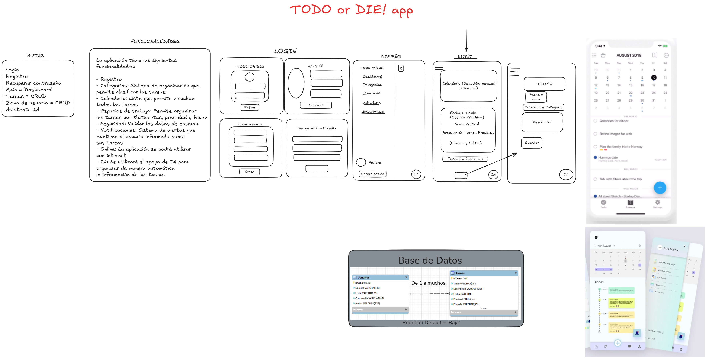

# TODO_or_DIE

Proyecto final del **Módulo 5** del curso **IFCD0022 · Fullstack JS 2026**.

## Descripción

_Pendiente: describir el objetivo de la aplicación y sus funcionalidades principales._

## Tecnologías

_Pendiente: indicar el stack (frontend, backend, base de datos, etc.)._

## Instalación

```bash
git clone https://github.com/IFCD0022-Fullstack-JS-2026/TODO_or_DIE.git
cd TODO_or_DIE
```

_Pendiente: añadir los pasos de instalación y arranque._

## Normas

Prohibido utilizar IA para generar código.

## Flujo de trabajo

Revisor: @armandolap. `main` y `develop` están protegidas: todo entra en `develop` mediante Pull Request aprobada por el revisor.

Nombre de rama: `tipo/<nº issue>-<descripcion>`, por ejemplo `feature/12-login` o `fix/27-borrar-tarea`.

Tipos de commit: `feat` (nueva funcionalidad), `fix` (corrección de un bug), `docs` (documentación), `style` (formato sin cambiar la lógica), `refactor` (reorganizar código sin cambiar su comportamiento), `test` (tests), `chore` (configuración y dependencias).

### Con cada issue asignada

```bash
# 1. Actualizar develop
git switch develop
git pull origin develop

# 2. Crear la rama de la issue
git switch -c feature/12-login

# 3. Trabajar y hacer commits
git add .
git commit -m "feat: añade formulario de login (#12)"

# 4. Traer los últimos cambios de develop a tu rama
git fetch origin
git merge origin/develop --no-edit

# 5. Subir la rama
git push -u origin feature/12-login
```

6. Abrir la Pull Request en GitHub contra `develop`, con `Closes #12` en la descripción.
7. Si el revisor pide cambios: corregir en la misma rama, `git commit` y `git push`.
8. Tras el merge:

```bash
git switch develop
git pull origin develop
git branch -d feature/12-login
```

Conflictos en el paso 4: resolverlos en el editor y después `git add .` y `git commit --no-edit`.

No hacer commits en `develop` ni en `main`. No usar `git push --force`.

## Tablero del proyecto

<https://github.com/orgs/IFCD0022-Fullstack-JS-2026/projects/1>

- Las issues nuevas se añaden solas al tablero.
- Al empezar una issue, mueve su tarjeta a `In Progress` a mano.
- Al mezclar la PR con `Closes #12`, la issue se cierra y pasa sola a `Done`.

## Equipo

- Dani
- Douglas
- Sergi Pérez Marí
- Maria
- Saida
- Marwa
- Juan
- Carlos


## Licencia

Distribuido bajo licencia MIT. Ver [LICENSE](LICENSE).

## Diseño




